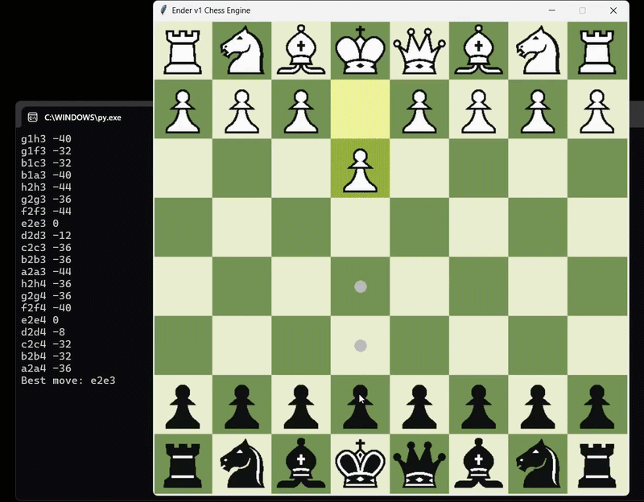

<div align="center">

# ♟️ Ender Chess Engine

*A Chess Engine written from scratch in Python using Minimax, Alpha-Beta Pruning, and custom board evaluation.*




</div>

---

# Overview

This project is a **homebrew Chess Engine** built entirely in **Python**.

It uses classical chess AI techniques including **Minimax**, **Alpha-Beta Pruning**, **Move Ordering**, and a handcrafted evaluation function to determine the strongest move from any legal position.

The goal of this project was to understand how modern chess engines search and evaluate positions rather than relying on machine learning.

---

# Features

- Play against the engine through a graphical interface
- Minimax Search
- Alpha-Beta Pruning
- Move Ordering
- Material Evaluation
- Piece-Square Tables
- Mobility Evaluation
- Bishop Pair Bonus
- Legal move generation using `python-chess`

---

# Demonstration

<p align="center">

</p>

---

# Project Structure

```text
Chess-Engine
│
├── chess_pieces/             # Chess piece images
│
├── Chess_GUI.py              # Graphical interface
├── PLAY_CHESS.py             # Main entry point
├── engine.py                 # Engine controller
├── evaluation.py             # Board evaluation
├── move_ordering.py          # Move ordering heuristics
├── openings.py               # Opening moves
├── piece_square_table.py     # PST values
├── search.py                 # Minimax + Alpha-Beta
│
├── LICENSE
└── README.md
```

---

# Installation

Clone the repository.

```bash
git clone https://github.com/YOUR_USERNAME/Chess-Engine.git
```

Enter the project.

```bash
cd Chess-Engine
```

---

# Running the Engine

Simply execute

```bash
python PLAY_CHESS.py
```

The GUI will launch automatically.

---

# Technologies Used

- Python
- python-chess

---

# License

This project is licensed under the MIT License.

---

# Author

**Tharun R**

GitHub:
https://github.com/YOUR_USERNAME

If you found this project interesting, consider giving it a ⭐.